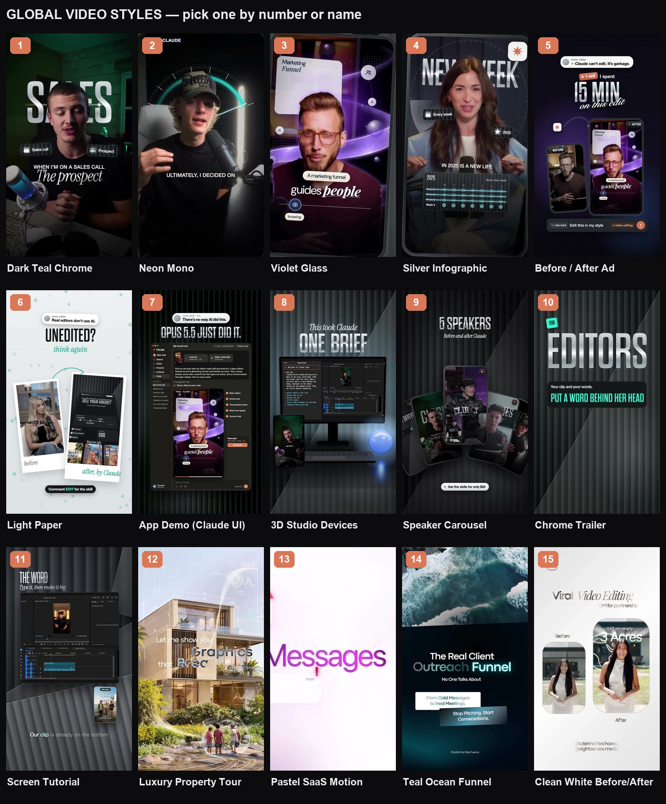

# Claude Video Styles

15 complete video-editing styles for **Claude Code**, with a numbered picture gallery, a free sound-effects library of 8,000+ sounds, and a frame-exact talking-head cutter.

You give Claude your recording, pick a style by number, and it edits the video: cut, captions, motion graphics, text behind your head, sound effects, music, render.



## Install (the easy way)

Open Claude Code and say:

> Claude, télécharge-moi et installe-moi tous les skills eli fel repo hedha: `<link of this repo>`

or in English:

> Download and install all the skills in this repo: `<link of this repo>`

Claude follows the « Install » steps below by itself.

## Use

1. **« Show me the picture with all the styles »**: Claude sends the gallery above.
2. Give it your recording (phone or camera, plus a separate mic file if you have one).
3. **« I pick number 5, edit my video »**: it cuts the video, shows you the clean cut, builds the style, and renders only when you say so.

## What's inside

| Skill | What it does |
|---|---|
| `skills/global-video-styles` | 15 styles, each with exact palette, fonts, 1080×1920 layout, every graphic element, motion timings, captions, transitions, sound map and a Remotion build recipe. Gallery + intake questions. SFX tools: download, search by sound (`sfx_match.py`), synthesise. |
| `skills/tunisian-clean-cut` | Cuts a raw talking-head recording (Tunisian Derja + French + English): pauses, retakes, false starts, stutters, repeated words. It always keeps the last take, and cuts the 4K camera file on the same frames as the mic. |

The 15 styles: 1 Dark Teal Chrome · 2 Neon Mono · 3 Violet Glass · 4 Silver Infographic · 5 Before/After Ad · 6 Light Paper · 7 App Demo (Claude UI) · 8 3D Studio Devices · 9 Speaker Carousel · 10 Chrome Trailer · 11 Screen Tutorial · 12 Luxury Property Tour · 13 Pastel SaaS Motion · 14 Teal Ocean Funnel · 15 Clean White Before/After.

## Install (the steps Claude runs)

Requirements: Windows 10/11, [Claude Code](https://claude.com/claude-code), Python 3.12, [ffmpeg](https://ffmpeg.org) on PATH, Node.js 20+ (for Remotion). An NVIDIA GPU is recommended: transcription and rendering are much faster.

1. **Skills**: copy `skills/global-video-styles` and `skills/tunisian-clean-cut` into `%USERPROFILE%\.claude\skills\`.
2. **Python environment**:
   ```bat
   python -m venv %USERPROFILE%\.venvs\claude-video
   %USERPROFILE%\.venvs\claude-video\Scripts\python.exe -m pip install -r requirements.txt
   ```
3. **Models** go in `%LOCALAPPDATA%\reel-pro-edit\models\`:
   - `rvm_mobilenetv3_fp32.onnx`, the person matte used for text behind the head: https://github.com/PeterL1n/RobustVideoMatting/releases/download/v1.0.0/rvm_mobilenetv3_fp32.onnx
   - `face_landmarker.task`, which detects script-reading glances: https://storage.googleapis.com/mediapipe-models/face_landmarker/face_landmarker/float16/1/face_landmarker.task

   Whisper `large-v3` downloads itself the first time you transcribe.
4. **Sound effects library**: downloaded to your PC from the free sources. Run from `skills/global-video-styles` with the venv python.
   ```bat
   python scripts\sfx_fetch.py mixkit-all
   python scripts\sfx_fetch.py freesound-file sfx\freesound_queries.txt
   python scripts\sfx_fetch.py uisfx
   python scripts\sfx_packs.py kenney
   python scripts\sfx_packs.py oga
   python scripts\build_bank.py restore
   ```
   This core set is about 3.5 GB. Optional pro packs (Sonniss #GameAudioGDC 2026 + 2024, about 39 GB), from Git Bash:
   ```bash
   bash scripts/packs_tools/fetch_sonniss.sh 2026 2024
   python scripts/sfx_packs.py index
   ```

## Sound effects

All of them are free for commercial videos (Instagram, TikTok, YouTube, client work), and none needs a credit:
- Mixkit's full catalogue;
- 1,900+ Freesound sounds, CC0 only;
- uisfx, Kenney and OpenGameArt CC0 packs;
- optionally the Sonniss GDC bundles.

Every sound is quality-checked, normalised and indexed. `sfx_match.py` finds the closest sound to any reference clip.

The sound files themselves are **not** stored in this repo. Mixkit's and Sonniss's licences don't allow sharing the raw files, so the scripts download them on your PC from the official sources. Full details are in [`skills/global-video-styles/sfx/LICENSES.md`](skills/global-video-styles/sfx/LICENSES.md). Use the sounds inside your videos; never resell them as a sound pack, and never register them with Content ID.

## Credits

The styles were rebuilt by Claude from a frame-by-frame study of the public reels of [@eightsenses.media](https://www.instagram.com/eightsenses.media/): what is on screen, the timings and the measured sound. No paid files from that creator are in this repo. The gallery pictures are frames from those public reels, shown only to say which look each style reproduces.
